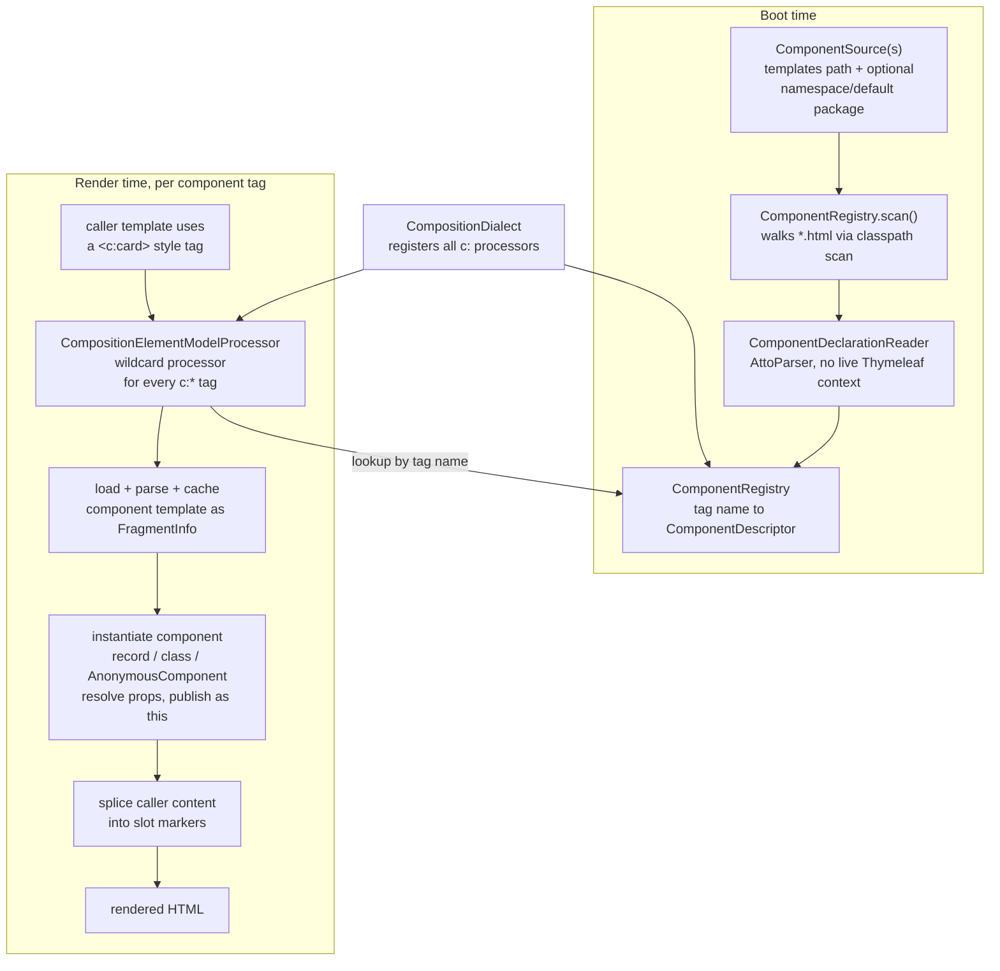
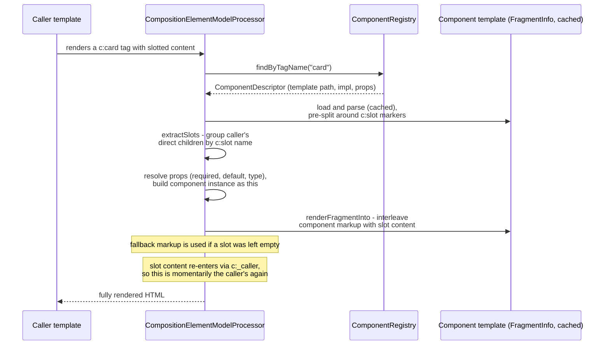

# Architecture overview

This is an internal doc for developers onboarding onto the codebase. For user-facing behavior, see [docs/reference](../reference/).

## What this project is

A [Thymeleaf](https://www.thymeleaf.org/) dialect (`c:` prefix) that adds UI-component semantics on top of plain HTML templates: components, slots, props. It's a single Gradle module — `src/main/java/blynx/thymeleaf/compositiondialect/` — with no runtime dependency on Thymeleaf itself (`compileOnly`/`testImplementation` only, so the host app's Thymeleaf version wins).

**Core idea — template-first components.** A component is just an HTML file that starts with a `<c:component>` declaration. The file's basename is the tag name (`card.html` → `<c:card>`). A backing Java class is optional (`impl="..."`), used only when you need real logic; a markup-only component works without one. This replaced an earlier, class-first design (annotated `CompositionComponent` subclasses discovered by classpath scan) — see `_local-notes/TEMPLATE-FIRST-COMPONENTS.md` for the rationale.

## Two phases: boot-time scan, render-time rendering



`CompositionDialect` (`CompositionDialect.java`) is the entry point. Constructed with one or more `ComponentSource`s, it builds the `ComponentRegistry` immediately (fail fast on collisions, reserved names, empty sources) and hands out its processors via `getProcessors(prefix)`. Registration happens either manually (`templateEngine.addDialect(...)`) or via Spring Boot auto-configuration (`CompositionDialectAutoConfiguration`), which also wires a startup verifier that resolves every component's template through the app's real Thymeleaf resolver chain — so a broken reference fails at boot, not on first render.

## The processors

All registered by `CompositionDialect.getProcessors`:

| Processor | Role |
|---|---|
| `CompositionElementModelProcessor` | The engine. One wildcard processor claims every `c:*` element, looks it up in the registry, and renders it (see below). |
| `CompositionRestAttributesTagProcessor` | Implements `c:rest` — spreads attributes the component didn't declare as props onto the element carrying it. |
| `CompositionCallerProcessor` | Internal `c:_caller` marker — restores the caller's `this` while slot content (written in the caller's scope) renders inside the component's subtree. |
| `CompositionSlotPlacementProcessor` (HTML + XML) | Catches a `c:slot` that reached normal processing unconsumed — i.e. misspelled or misplaced — and fails loudly rather than silently dropping it. |
| `CompositionUnresolvedTagProcessor` (XML only) | Catch-all reporting any unresolved `c:*` tag in XML mode (the HTML wildcard processor already covers this case for HTML). |

The dialect fails loudly by design: unresolved tags, misplaced slot markers, and prop/`impl` conflicts are all boot- or render-time errors, not silent no-ops.

## Rendering a component: slots and props



Slots have no dedicated "happy path" processor — they're a model transformation inside `CompositionElementModelProcessor` (`parseFragment`, `extractSlots`, `renderFragmentInto`). Only the *misuse* case (a stray, unconsumed `c:slot`) gets its own processor.

Props come from one of two places, never both (declaring both is a startup error):
- **Classless components**: `props="a,b"` shorthand or paired `<c:prop name="..." required default="..." type="...">` children, parsed by `ComponentDeclarationReader` into `PropSpec`s. The component is exposed as `AnonymousComponent`, a `Map`-backed instance.
- **Class-bound components** (`impl="..."`): props are whatever the class already exposes — a record's canonical-constructor components, or `@Prop`-annotated fields on a plain class. The class's own shape *is* the prop declaration.

## Namespaces and libraries

A `ComponentSource` optionally declares a `tagNamespace`; every template under that source must then be named `<namespace>-*` (enforced at scan time), e.g. `webawesome/wa-button.html` → `<c:wa-button>`. All sources share one `c:` prefix and one registry — the tag name alone (namespaced or not) is what keeps libraries from colliding. A library ships either a Spring `ComponentSource` `@Bean`, or — for a pure-HTML, Java-free library — a classpath descriptor at `META-INF/thymeleaf-composition/source.properties`, discovered via `ComponentSource.discoverFromClasspath()`. Either way, a library's templates resolve through the *consuming application's* Thymeleaf resolver chain, not one the library brings itself.

## Where things live

```
src/main/java/blynx/thymeleaf/compositiondialect/
├── CompositionDialect.java                  entry point, wires processors + registry
├── CompositionDialectAutoConfiguration.java Spring Boot wiring + boot-time template verification
├── ComponentSource.java                     where to scan, optional namespace/default package
├── ComponentRegistry.java                   boot-time scan, tag name -> ComponentDescriptor
├── ComponentDeclarationReader.java          AttoParser-based reader for <c:component>/<c:prop>
├── ComponentDescriptor.java / PropSpec.java records describing a scanned component
├── CompositionElementModelProcessor.java    the rendering engine (slots, props, caching)
├── CompositionRestAttributesTagProcessor.java  c:rest
├── CompositionCallerProcessor.java          c:_caller (internal slot-scope marker)
├── CompositionSlotPlacementProcessor.java   stray c:slot -> error (HTML + XML)
├── CompositionUnresolvedTagProcessor.java   stray c:* -> error (XML only)
├── AnonymousComponent.java / AbstractCompositionComponent.java / Prop.java / PropCoercion.java
└── ComponentFrame.java / ComponentAttributes.java / CompositionComponent(Context).java
```

## Tests

`src/test/resources/templates/cases/` is a template-per-behavior spec: each `.html` has a `CASE`/`EXPECT` header and (usually) a paired `.expected.html`, rendered and diffed by `CasesTest`/`CaseRenderer`. Subfolders: `slots/`, `scope/`, `control-flow/`, `context/`, `attributes/`, `modules/`. This is the fastest way to see what a behavior actually does — grep there before reading processor internals.

## Further reading

- User-facing behavior: [docs/reference](../reference/)
